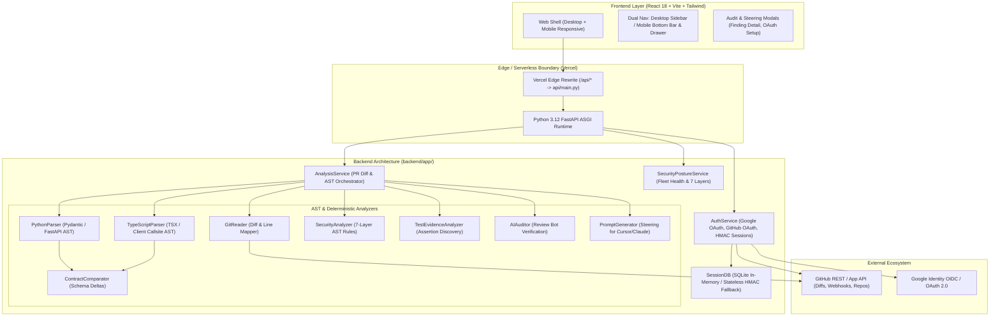
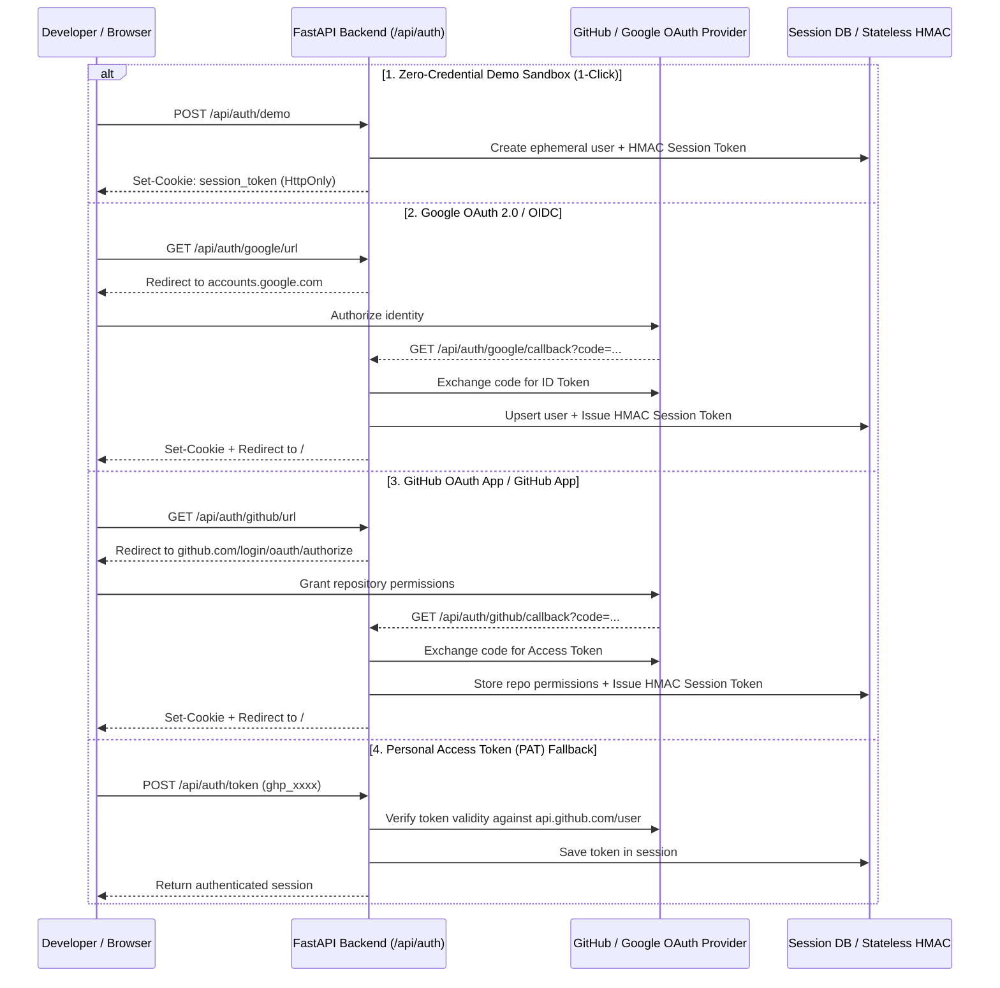

# PROJECT_BRAIN.md — REGRAVA Platform Architecture & Knowledge Base

> **Single Source of Truth** for the REGRAVA (RepoSentinel) Static Analysis & Regression Engine.  
> *Last Updated: November 2026* • *Version: 2.0.0* • *Live URL: [https://regrava.vercel.app](https://regrava.vercel.app)*

---

## 1. Executive Summary & Core Philosophy

**REGRAVA** (*Regression & Vulnerability Auditor*, formerly *RepoSentinel*) is a high-assurance, deterministic developer security and cross-repository API regression platform. It bridges the critical divide between backend API evolution (e.g., FastAPI, Pydantic) and frontend client consumers (e.g., React, TypeScript, Next.js).

### The Core Problem
Modern pull requests are frequently reviewed by AI code bots (e.g., Copilot PR Reviewer, CodeRabbit, Codium). While these tools catch surface-level typos, they suffer from two fatal blind spots:
1. **Cross-Boundary Blindness**: A backend developer modifies a field in a Pydantic schema (e.g., renaming `user_id` to `id`). The backend unit tests pass. However, 14 TypeScript components across another repository break in production with `TypeError: Cannot read properties of undefined`.
2. **Stochastic Hallucinations**: LLMs guess whether a change is breaking or vulnerable. They hallucinate non-existent issues (high false-positive fatigue) or overlook silent injection vulnerabilities and contract mismatches.

### The REGRAVA Philosophy: Deterministic AST > Stochastic Hallucinations
* **Deterministic Compiler Traversal**: Every rule, taint flow, and schema delta is evaluated via concrete Abstract Syntax Tree (AST) analysis in Python and TypeScript. Zero LLM guessing during the primary analysis pass.
* **Sub-35ms Execution**: In-memory AST construction and symbol resolution finish in milliseconds.
* **Zero Cloud Retention Architecture**: Code diffs are processed entirely in ephemeral memory buffers. Zero proprietary source code is retained on disk or stored in external databases.
* **Full-Stack Bi-Directional Mapping**: Correlates backend Python endpoints with consumer frontend TypeScript interfaces and component callsites.
* **Automated Evidence & Test Synthesis**: Detects whether modified code paths have matching unit tests; synthesizes verified Vitest/pytest contract proofs when missing.

---

## 2. System Architecture & High-Level Topology



---

## 3. The 7-Layer AST Security Engine

REGRAVA inspects repository source code and active pull request diffs across 7 discrete static analysis layers:

| Layer | Subsystem | Target Vulnerabilities | AST Detection Mechanism |
|---|---|---|---|
| **L1** | **Secrets & Keys** | Hardcoded JWT secrets, AWS/GCP tokens, private keys, database URLs | AST constant literal inspection, Shannon entropy analysis, regex pattern matching |
| **L2** | **Injection** | SQL Injection, Command Injection, XSS, SSRF | Unsanitized string formatting in database queries (`cursor.execute(f"...")`), unescaped innerHTML in TSX |
| **L3** | **Auth & IDOR** | Insecure Direct Object References, missing route guards | FastAPI route handlers lacking `Depends(get_current_user)`, unprotected mutation endpoints |
| **L4** | **Input Validation** | Path Traversal, arbitrary file uploads, unvalidated payloads | Direct filesystem operations with user-supplied arguments (`os.path.join` without sanitization) |
| **L5** | **Config & CORS** | Wildcard CORS (`allow_origins=["*"]`), debug flags enabled | AST inspection of `CORSMiddleware`, settings files (`DEBUG = True` in production) |
| **L6** | **Supply Chain** | Vulnerable dependencies, deprecated packages, pinned CVEs | Manifest parser for `pyproject.toml`, `requirements.txt`, and `package.json` |
| **L7** | **API Contracts** | Breaking response/request schemas, missing fields, type shifts | Cross-boundary alignment between Pydantic models and frontend TypeScript consumers |

---

## 4. Key Subsystems & Feature Breakdown

### 4.1 Cross-Boundary Contract Regression Comparator
* **Problem**: Backend engineers frequently rename or remove fields in API schemas. TypeScript clients silently fail when accessing `response.data.<old_field>`.
* **Solution**:
  1. [`python_parser.py`](file:///C:/Users/ASUS/.gemini/antigravity/scratch/reposentinel/backend/app/analyzer/python_parser.py) parses Pydantic models from base and head branches, extracting exact field definitions, types, and defaults.
  2. [`typescript_parser.py`](file:///C:/Users/ASUS/.gemini/antigravity/scratch/reposentinel/backend/app/analyzer/typescript_parser.py) scans connected frontend repositories for API client calls (`api.get('/users')`), type interfaces, and JSX component prop usage.
  3. [`contract_comparator.py`](file:///C:/Users/ASUS/.gemini/antigravity/scratch/reposentinel/backend/app/analyzer/contract_comparator.py) computes schema deltas: `fields_added`, `fields_removed`, `type_changed`, and maps direct consumer impacts.

### 4.2 Test Evidence & Automated Synthesis
* [`test_evidence.py`](file:///C:/Users/ASUS/.gemini/antigravity/scratch/reposentinel/backend/app/analyzer/test_evidence.py) evaluates whether a modified endpoint or contract field has dedicated assertions in the test suite (`tests/` or `__tests__/`).
* If no test is detected, the engine flags a **Test Evidence Gap** and synthesizes a verified test snippet (e.g., Vitest contract assertion or pytest integration test) in the finding details.

### 4.3 AI Review Auditor & Prompt Steering
* **AI Review Auditor** ([`ai_auditor.py`](file:///C:/Users/ASUS/.gemini/antigravity/scratch/reposentinel/backend/app/analyzer/ai_auditor.py)): Ingests comments left on pull requests by AI review bots (e.g., CodeRabbit, Copilot). Validates each comment against deterministic AST evidence, categorizing comments as:
  * `verified_valid`: Confirmed by AST fact.
  * `hallucination_false_positive`: Debunked by compiler AST facts.
  * `contract_regression`: AI proposed a fix that would break consumer code.
  * `noise`: Low-value stylistic nitpick.
* **Prompt Steering Generator** ([`prompt_generator.py`](file:///C:/Users/ASUS/.gemini/antigravity/scratch/reposentinel/backend/app/analyzer/prompt_generator.py)): Produces surgically tailored prompts with **Strict Negative Constraints** for developer AI agents (Cursor Composer, Claude Code, GitHub Copilot) to repair the issue without inducing secondary regressions.

### 4.4 Fleet Security Posture & Health Grading
* Evaluates all authorized repositories across the fleet.
* Assigns a deterministic letter grade (**A+**, **A**, **B**, **C**, **D**, **F**) based on the 7-layer health checklist.
* Computes compliance readiness scores for **SOC 2 Type II** and **OWASP Top 10**.

---

## 5. Technology Stack & Dependencies

### Backend Stack
| Layer | Technologies |
|---|---|
| **Runtime** | Python 3.12 (Vercel Serverless environment), Python 3.14 (Local dev compatible) |
| **Framework** | FastAPI 0.115+, Starlette, Uvicorn |
| **Parsing & AST** | Python standard library `ast`, regex AST tokenizers |
| **Data Validation** | Pydantic v2 (`BaseModel`, `Field`, `BaseSettings`) |
| **HTTP Client** | HTTPX (Async & Sync with connection pooling) |
| **Database** | SQLite (with WAL mode) + In-Memory Fallback |
| **Testing** | Pytest 9.1+, pytest-asyncio, AnyIO |

### Frontend Stack
| Layer | Technologies |
|---|---|
| **Framework** | React 18, TypeScript 5.5+ |
| **Build Tool** | Vite 6.4+ (Rollup bundle generation) |
| **Styling** | Tailwind CSS 3.4+, custom Obsidian dark theme (`#08090C`, `#111318`, `#7657FF`) |
| **Icons** | Lucide React |
| **Responsive Shell** | Dynamic `100dvh` viewport, slide-out mobile drawer, fixed thumb bottom bar |

---

## 6. Directory Structure & Key Files

```
reposentinel/
├── .github/
│   └── workflows/
│       └── reposentinel.yml          # GitHub Actions CI for PR scanning
├── backend/
│   ├── app/
│   │   ├── analyzer/                 # Deterministic AST Analyzers
│   │   │   ├── ai_auditor.py         # Audits third-party AI bot review comments
│   │   │   ├── contract_comparator.py# Compares Pydantic vs TypeScript schema deltas
│   │   │   ├── git_reader.py         # Unified diff parser & line mapper
│   │   │   ├── prompt_generator.py   # AI prompt steering with negative constraints
│   │   │   ├── python_parser.py      # Python AST schema and route extractor
│   │   │   ├── report_builder.py     # Structures analysis summary & metrics
│   │   │   ├── risk_assessor.py      # Calculates risk score & blast radius
│   │   │   ├── security_analyzer.py  # 7-layer AST vulnerability engine
│   │   │   ├── test_evidence.py      # Detects test coverage for modified symbols
│   │   │   └── typescript_parser.py  # TypeScript / React client AST extractor
│   │   ├── api/                      # REST API Endpoints
│   │   │   ├── ai_steering.py        # /api/steering/prompt & /api/steering/audit
│   │   │   ├── analysis.py           # /api/analysis/pr, /api/analysis/history
│   │   │   ├── auth.py               # /api/auth/google, /api/auth/github, /api/auth/me
│   │   │   ├── health.py             # /api/health
│   │   │   └── security.py           # /api/security/posture, /api/security/audit
│   │   ├── db/
│   │   │   └── session_db.py         # SQLite database & token revocation tables
│   │   ├── models/                   # Pydantic Schemas
│   │   │   ├── analysis.py           # PRAnalysisResult, DiffSummary
│   │   │   ├── contract.py           # APIContractDelta, SchemaField
│   │   │   ├── finding.py            # Finding, FindingSeverity, ReviewStatus
│   │   │   └── prompt_steering.py    # SteeredPromptResponse, AIAuditReport
│   │   ├── services/                 # Core Business Logic
│   │   │   ├── analysis_service.py   # Orchestrates multi-step PR analysis
│   │   │   ├── auth_service.py       # Dual-layer session & OAuth logic
│   │   │   ├── github_service.py     # GitHub API connector & token manager
│   │   │   └── security_posture_service.py # Fleet health & compliance scoring
│   │   ├── config.py                 # Application settings & environment variables
│   │   └── main.py                   # ASGI application setup & router mounting
│   ├── tests/                        # 51 Pytest Test Cases
│   │   ├── test_ai_auditor.py
│   │   ├── test_api_endpoints.py
│   │   ├── test_auth_and_sessions.py
│   │   ├── test_contract_comparator.py
│   │   ├── test_git_reader.py
│   │   ├── test_pr_analysis.py
│   │   ├── test_prompt_generator.py
│   │   ├── test_python_parser.py
│   │   ├── test_scenarios_integration.py
│   │   ├── test_security_analyzer.py
│   │   ├── test_security_posture.py
│   │   └── test_typescript_parser.py
│   └── pyproject.toml                # Poetry/UV build configuration
├── frontend/
│   ├── src/
│   │   ├── components/               # UI Components
│   │   │   ├── FindingDetailModal.tsx# Finding inspector, prompt steering & auditor
│   │   │   ├── GitHubOAuthSetupModal.tsx # In-app OAuth credentials modal
│   │   │   ├── GoogleOAuthSetupModal.tsx # In-app Google OAuth credentials modal
│   │   │   ├── Header.tsx            # Desktop & mobile responsive header
│   │   │   └── Sidebar.tsx           # Fixed sidebar, mobile drawer & bottom bar
│   │   ├── pages/                    # Route Views
│   │   │   ├── AnalysisHistoryPage.tsx   # Historical scan audit logs
│   │   │   ├── AuthPage.tsx          # Landing page, AST visualizer & sign-in
│   │   │   ├── FindingsPage.tsx      # Multi-faceted finding triage center
│   │   │   ├── OverviewPage.tsx      # Platform overview & quick scan launcher
│   │   │   ├── PullRequestsPage.tsx  # PR diff inspector & contract delta viewer
│   │   │   ├── RepositoriesPage.tsx  # Connected repository manager
│   │   │   ├── SecurityDashboardPage.tsx # Fleet posture & 7-layer radar
│   │   │   └── SettingsPage.tsx      # Identity, PAT entry & OAuth settings
│   │   ├── services/
│   │   │   └── api.ts                # Frontend Axios/Fetch client
│   │   ├── types/
│   │   │   └── index.ts              # TypeScript interface definitions
│   │   ├── App.tsx                   # Main root view & mobile state container
│   │   ├── index.css                 # Obsidian dark theme, animations & safe areas
│   │   └── main.tsx                  # React DOM root mounting
│   ├── package.json
│   ├── tsconfig.json
│   └── vite.config.ts
├── examples/                         # Verified benchmark demo projects
│   └── demo_project/                 # Demonstrates real cross-repo contract breaks
├── api/                              # Vercel Serverless Function Bridge
│   └── main.py                       # Top-level ASGI redirect to backend/app/main.py
├── vercel.json                       # Vercel deployment routes & builds
└── PROJECT_BRAIN.md                  # This document
```

---

## 7. Authentication & Session Architecture

REGRAVA provides four flexible sign-in mechanisms while upholding strict isolation:



### The Multi-Container Serverless Fallback (Stateless HMAC)
On serverless platforms like Vercel, requests hit isolated, ephemeral containers that do not share a persistent SQLite database. To solve session loss across cold starts:
1. `AuthService.generate_session_token(...)` packs essential user identity (`sub`, `email`, `name`, `gh_user`, `repos`) into an HMAC-SHA256 tamper-evident signed token (`format: payload.hmac_signature`).
2. When a request hits a fresh serverless instance where SQLite is uninitialized:
   * `get_current_user_optional` verifies the HMAC signature using `settings.SECRET_KEY`.
   * If valid, it dynamically restores the user's session and GitHub credentials in memory, providing true zero-downtime, stateless horizontal scaling.

---

## 8. Mobile & Responsive UX Architecture

The entire REGRAVA frontend is engineered to render cleanly on touchscreens and viewports from 360px up to 4K displays:

1. **Dual Navigation Model**:
   * **Desktop (`md:` and up)**: Fixed permanent sidebar (240px width).
   * **Mobile (`md:hidden`)**: Fixed bottom navigation bar with thumb-accessible icons for the top 5 views + a slide-out drawer with backdrop blur overlay (`bg-black/75 backdrop-blur-sm`) for the complete menu.
2. **Safe Area & Tap Latency Insets**:
   * Root layout uses `h-[100dvh]` to eliminate mobile URL bar jumping.
   * `pb-16 md:pb-0` applied to `<main>` to prevent content occlusion by the bottom bar.
   * `touch-action: manipulation` applied globally in `index.css` to remove the 300ms tap delay on mobile browsers.
   * `.safe-top` and `.safe-bottom` utilities leverage `env(safe-area-inset-top)` and `env(safe-area-inset-bottom)` for iPhone notches.

---

## 9. API Reference & Endpoint Specification

### Authentication (`/api/auth`)
* `GET /api/auth/health` — Heartbeat check.
* `GET /api/auth/me` — Returns current authenticated user, provider, and authorized repositories.
* `POST /api/auth/demo` — Starts an instant zero-credential demo session.
* `GET /api/auth/google/url` — Returns configured Google OAuth consent URL.
* `GET /api/auth/google/callback` — Handles Google OAuth code exchange.
* `POST /api/auth/google/config` — Registers Google OAuth credentials in-app.
* `GET /api/auth/github/url` — Returns GitHub OAuth authorization URL.
* `GET /api/auth/github/callback` — Handles GitHub OAuth code exchange.
* `POST /api/auth/github/config` — Registers GitHub OAuth credentials in-app.
* `POST /api/auth/token` — Connects a direct GitHub Personal Access Token (PAT).
* `POST /api/auth/logout` — Revokes session token and clears cookies.

### PR Analysis (`/api/analysis`)
* `POST /api/analysis/pr` — Scans a pull request:
  ```json
  {
    "repo_owner": "Myparadox-creator",
    "repo_name": "REGRAVA",
    "pr_number": 1
  }
  ```
* `GET /api/analysis/history` — Lists all completed scan audits.
* `GET /api/analysis/{analysis_id}` — Retrieves full findings, contract deltas, and test evidence for a scan.
* `PATCH /api/analysis/findings/{finding_id}/status` — Updates triage status (`open`, `reviewed`, `dismissed`).

### Security Posture & Fleet Audit (`/api/security`)
* `GET /api/security/posture` — Returns fleet health score, letter grade, and 7-layer radar metrics.
* `POST /api/security/audit/{owner}/{repo}` — Triggers an on-demand 7-layer AST audit for a specific repository.

### AI Prompt Steering & Review Auditor (`/api/steering`)
* `POST /api/steering/prompt` — Generates a steered remediation prompt:
  ```json
  {
    "analysis_id": "...",
    "finding_id": "SEC-001",
    "target_tool": "cursor",
    "include_negative_constraints": true,
    "include_synthesized_test": true
  }
  ```
* `POST /api/steering/audit` — Audits third-party AI review bot comments against AST facts.

---

## 10. Developer & Operational Runbook

### Prerequisites
* Python 3.12+ (or 3.14)
* Node.js 18+ & npm
* Git CLI

### Local Development Setup

1. **Clone the Repository**:
   ```bash
   git clone https://github.com/Myparadox-creator/REGRAVA.git
   cd REGRAVA
   ```

2. **Backend Setup**:
   ```bash
   cd backend
   python -m venv .venv
   # Windows:
   .\.venv\Scripts\Activate.ps1
   # Linux/macOS:
   source .venv/bin/activate
   pip install -r ../requirements.txt
   ```

3. **Frontend Setup**:
   ```bash
   cd ../frontend
   npm install
   ```

4. **Running Locally**:
   * **Backend** (port 8000):
     ```bash
     cd backend
     python -m uvicorn app.main:app --reload --port 8000
     ```
   * **Frontend** (port 5173):
     ```bash
     cd frontend
     npm run dev
     ```
   * The app is accessible at `http://localhost:5173`. API requests proxy automatically to `http://localhost:8000`.

### Running Automated Test Suites

* **Backend Unit & Integration Tests (51 cases)**:
  ```bash
  cd backend
  $env:PYTHONPATH="."  # Windows PowerShell
  pytest tests
  ```
* **Frontend Type-Check & Build Verification**:
  ```bash
  cd frontend
  npm run build
  ```

---

## 11. Vercel Serverless Deployment Architecture

REGRAVA is deployed on Vercel as a hybrid application:
* **Static Assets**: Frontend is built via `npm run build` into `frontend/dist`.
* **Serverless Functions**: API requests under `/api/(.*)` route to `api/main.py`.

### Critical Vercel AST Rules
* **`[PYTHON_HANDLER_NOT_FOUND]` Prevention**: Vercel's Python AST parser (`@vercel/python-analysis`) inspects top-level statements for `app = ...` using Rust. Statements nested inside `try/except` blocks are ignored by the parser. Therefore, `api/main.py` explicitly instantiates `app = FastAPI()` at the module top level before delegating to `backend/app/main.py`.
* **Python 3.12 Annotation Resolution**: Class type annotations (e.g. `comparison: Any`) are evaluated at import time in Python 3.12. All services include `from __future__ import annotations` and explicit imports to prevent runtime `NameError` crashes during cold starts.

---

## 12. Security, Privacy & Compliance Guarantees

* **Zero-Retention Guarantee**: Source code is processed strictly in-memory during AST tree construction. No code files or customer diffs are written to permanent databases.
* **Minimal Scopes**: GitHub OAuth and Apps request read-only permissions (`contents: read`, `pull_requests: read`). Write access to code is never requested.
* **Tamper-Evident Sessions**: All authentication tokens and state parameters use HMAC-SHA256 signatures with server-side secrets. Cookies are marked `HttpOnly`, `SameSite=Lax`, and `Secure` in production.
* **Audit Trail**: Every analyzed PR records a deterministic, timestamped audit log verifying compiler checks passed before merging.
