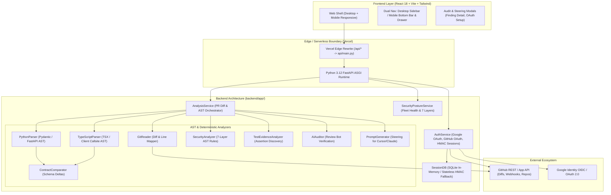
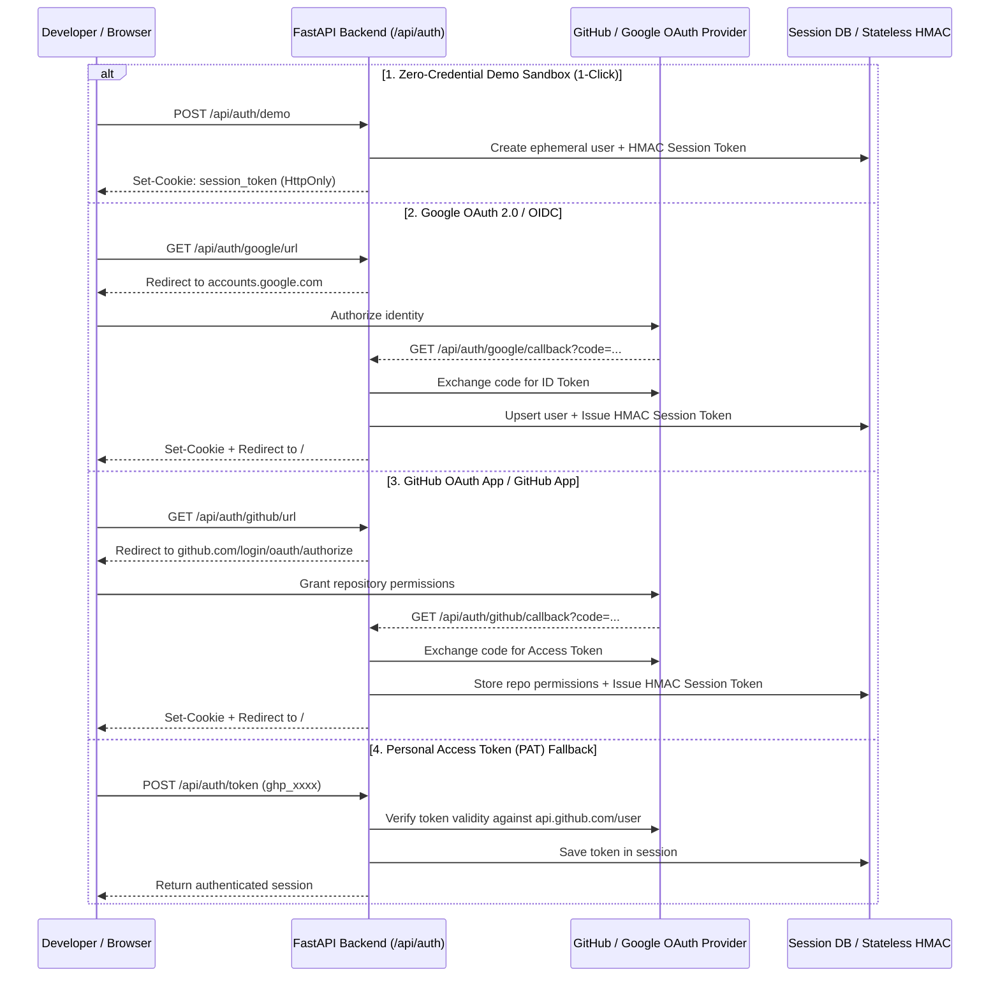

# PROJECT_BRAIN.md — REGRAVA Platform Architecture & Knowledge Base

> **Single Source of Truth** for the REGRAVA (RepoSentinel) Static Analysis & Regression Engine.  
> *Last Updated: November 2026* • *Version: 2.0.0* • *Live URL: [https://regrava.vercel.app](https://regrava.vercel.app)*

---

## 1. Executive Summary & Core Philosophy

**REGRAVA** (*Regression & Vulnerability Auditor*, formerly *RepoSentinel*) is a high-assurance, deterministic developer security and cross-repository API regression platform. It bridges the critical divide between backend API evolution (e.g., FastAPI, Pydantic) and frontend client consumers (e.g., React, TypeScript, Next.js).

### The Core Problem
Modern pull requests are frequently reviewed by AI code bots (e.g., Copilot PR Reviewer, CodeRabbit, Codium). While these tools catch surface-level typos, they suffer from two fatal blind spots:
1. **Cross-Boundary Blindness**: A backend developer modifies a field in a Pydantic schema (e.g., renaming `user_id` to `id`). The backend unit tests pass. However, 14 TypeScript components across another repository break in production with `TypeError: Cannot read properties of undefined`.
2. **Stochastic Hallucinations**: LLMs guess whether a change is breaking or vulnerable. They hallucinate non-existent issues (high false-positive fatigue) or overlook silent injection vulnerabilities and contract mismatches.

### The REGRAVA Philosophy: Deterministic AST > Stochastic Hallucinations
* **Deterministic Compiler Traversal**: Every rule, taint flow, and schema delta is evaluated via concrete Abstract Syntax Tree (AST) analysis in Python and TypeScript. Zero LLM guessing during the primary analysis pass.
* **Sub-35ms Execution**: In-memory AST construction and symbol resolution finish in milliseconds.
* **Zero Cloud Retention Architecture**: Code diffs are processed entirely in ephemeral memory buffers. Zero proprietary source code is retained on disk or stored in external databases.
* **Full-Stack Bi-Directional Mapping**: Correlates backend Python endpoints with consumer frontend TypeScript interfaces and component callsites.
* **Automated Evidence & Test Synthesis**: Detects whether modified code paths have matching unit tests; synthesizes verified Vitest/pytest contract proofs when missing.

---

## 2. System Architecture & High-Level Topology



---

## 3. The 7-Layer AST Security Engine

REGRAVA inspects repository source code and active pull request diffs across 7 discrete static analysis layers:

| Layer | Subsystem | Target Vulnerabilities | AST Detection Mechanism |
|---|---|---|---|
| **L1** | **Secrets & Keys** | Hardcoded JWT secrets, AWS/GCP tokens, private keys, database URLs | AST constant literal inspection, Shannon entropy analysis, regex pattern matching |
| **L2** | **Injection** | SQL Injection, Command Injection, XSS, SSRF | Unsanitized string formatting in database queries (`cursor.execute(f"...")`), unescaped innerHTML in TSX |
| **L3** | **Auth & IDOR** | Insecure Direct Object References, missing route guards | FastAPI route handlers lacking `Depends(get_current_user)`, unprotected mutation endpoints |
| **L4** | **Input Validation** | Path Traversal, arbitrary file uploads, unvalidated payloads | Direct filesystem operations with user-supplied arguments (`os.path.join` without sanitization) |
| **L5** | **Config & CORS** | Wildcard CORS (`allow_origins=["*"]`), debug flags enabled | AST inspection of `CORSMiddleware`, settings files (`DEBUG = True` in production) |
| **L6** | **Supply Chain** | Vulnerable dependencies, deprecated packages, pinned CVEs | Manifest parser for `pyproject.toml`, `requirements.txt`, and `package.json` |
| **L7** | **API Contracts** | Breaking response/request schemas, missing fields, type shifts | Cross-boundary alignment between Pydantic models and frontend TypeScript consumers |

---

## 4. Key Subsystems & Feature Breakdown

### 4.1 Cross-Boundary Contract Regression Comparator
* **Problem**: Backend engineers frequently rename or remove fields in API schemas. TypeScript clients silently fail when accessing `response.data.<old_field>`.
* **Solution**:
  1. [`python_parser.py`](file:///C:/Users/ASUS/.gemini/antigravity/scratch/reposentinel/backend/app/analyzer/python_parser.py) parses Pydantic models from base and head branches, extracting exact field definitions, types, and defaults.
  2. [`typescript_parser.py`](file:///C:/Users/ASUS/.gemini/antigravity/scratch/reposentinel/backend/app/analyzer/typescript_parser.py) scans connected frontend repositories for API client calls (`api.get('/users')`), type interfaces, and JSX component prop usage.
  3. [`contract_comparator.py`](file:///C:/Users/ASUS/.gemini/antigravity/scratch/reposentinel/backend/app/analyzer/contract_comparator.py) computes schema deltas: `fields_added`, `fields_removed`, `type_changed`, and maps direct consumer impacts.

### 4.2 Test Evidence & Automated Synthesis
* [`test_evidence.py`](file:///C:/Users/ASUS/.gemini/antigravity/scratch/reposentinel/backend/app/analyzer/test_evidence.py) evaluates whether a modified endpoint or contract field has dedicated assertions in the test suite (`tests/` or `__tests__/`).
* If no test is detected, the engine flags a **Test Evidence Gap** and synthesizes a verified test snippet (e.g., Vitest contract assertion or pytest integration test) in the finding details.

### 4.3 AI Review Auditor & Prompt Steering
* **AI Review Auditor** ([`ai_auditor.py`](file:///C:/Users/ASUS/.gemini/antigravity/scratch/reposentinel/backend/app/analyzer/ai_auditor.py)): Ingests comments left on pull requests by AI review bots (e.g., CodeRabbit, Copilot). Validates each comment against deterministic AST evidence, categorizing comments as:
  * `verified_valid`: Confirmed by AST fact.
  * `hallucination_false_positive`: Debunked by compiler AST facts.
  * `contract_regression`: AI proposed a fix that would break consumer code.
  * `noise`: Low-value stylistic nitpick.
* **Prompt Steering Generator** ([`prompt_generator.py`](file:///C:/Users/ASUS/.gemini/antigravity/scratch/reposentinel/backend/app/analyzer/prompt_generator.py)): Produces surgically tailored prompts with **Strict Negative Constraints** for developer AI agents (Cursor Composer, Claude Code, GitHub Copilot) to repair the issue without inducing secondary regressions.

### 4.4 Fleet Security Posture & Health Grading
* Evaluates all authorized repositories across the fleet.
* Assigns a deterministic letter grade (**A+**, **A**, **B**, **C**, **D**, **F**) based on the 7-layer health checklist.
* Computes compliance readiness scores for **SOC 2 Type II** and **OWASP Top 10**.

### 4.5 Native GitHub Pull Request Reviewer & Lifecycle Engine
* **Objective**: Positions REGRAVA directly inside the GitHub PR conversation as an independent, automated code and security reviewer (alongside tools like Strix, CodeRabbit, and Copilot).
* **Two-Tier Strix Review Format**:
  1. **Top Pinned PR Summary Comment** (`POST /repos/{owner}/{repo}/issues/{number}/comments`):
     - `# REGRAVA Security Review` heading.
     - `### To fix before merging ({count})`: Highlighted with colored badges (🟣 `CRITICAL`, 🔴 `HIGH`, 🟡 `MEDIUM`), finding title, and exact file:line references (e.g. `services/payments/routes.py:28-31`).
     - `**PR summary:**`: Plain-English summary of changed services and diff boundaries.
     - `<details><summary><b>Review summary</b></summary>`: Metrics, observations, and audit status.
     - `<details><summary><b>Ruled out ({count})</b></summary>`: Explicit list of AST security checks that verified clean (SQLi, Command Injection, Secrets, Path Traversal, XSS, Auth/IDOR, etc.).
     - Footer: Re-run instructions (`Fixed the findings? re-run the review, or tag @regrava in a PR comment to run a fresh review.`).
  2. **Formal Pull Request Review** (`POST /repos/{owner}/{repo}/pulls/{number}/reviews`, event=`COMMENT`):
     - Notification banner: *"REGRAVA flagged a new security finding below. See the pinned summary comment for the full PR status."*
     - Anchored inline comments on changed diff lines with **Problem**, **Why it matters**, **Recommended action**, **Confidence**, and **REGRAVA finding ID**.
* **Dual-Token Authentication Architecture**:
  - Automatically uses GitHub App installation tokens when `GITHUB_APP_ID` and private key are configured.
  - Automatically falls back to the connected user's authorized GitHub OAuth access token (or PAT in `GITHUB_TOKEN`) when App credentials are not configured, ensuring live reviews publish in any environment without falling back to local dry-run.
* **Review Idempotency & Duplicate Prevention**: Stable composite key (`repo_id:pr_number:head_sha:version:fingerprints`) prevents duplicate review comments on identical commits.
* **Cross-Commit Finding Lifecycle Tracking**: Tracks findings across revisions (`Open`, `Fix Attempted`, `Verified Fixed`, `Still Present`, `Dismissed`, `Accepted`, `Inconclusive`).
* **Webhook Re-Review Support**: Subscribed to `issue_comment` events to automatically trigger on-demand reviews when developers comment `@regrava review`, `@regrava re-run`, or `/regrava review`.
* **In-Dashboard Visual PR View**: Interactive GitHub conversation card mirroring the GitHub PR timeline directly inside the REGRAVA web application.

### 4.6 REVA — Native AI Assistant & Conversational Engine
* **Identity**: **REVA** (REGRAVA Evidence-based Vulnerability & Architecture Assistant) is the native intelligent conversational developer companion inside REGRAVA (inspired by modern developer AI tools like ChatGPT, Claude, and Antigravity) while preserving the Obsidian Black visual identity.
* **Multi-Provider LLM Abstraction**:
  - Abstract base interface (`BaseLLMProvider`) supporting streaming and non-streaming responses via native REST Server-Sent Events (SSE).
  - Primary provider: Google Gemini API (`gemini-2.0-flash`, `gemini-1.5-flash`, `gemini-1.5-pro`) using low-latency SSE streaming.
  - Pluggable extensions for OpenAI (`gpt-4o`) and Anthropic (`claude-3-5-sonnet`).
  - Dynamic in-app API key configuration with server-side credential isolation.
* **Controlled Read-Only Repository Tools (`AssistantTools`)**:
  - `get_repository_overview`: Repository metadata, default branch, language, and README excerpt.
  - `list_repository_files`: Directory tree exploration.
  - `search_repository_code`: Search files, symbols, and routes.
  - `read_source_file`: Line-numbered source inspection (capped at safe limit) with automatic secret redaction (`[REDACTED_SECRET]`).
  - `get_pull_request_details` & `get_pull_request_diff`: PR metadata and unified diff patches.
  - `get_security_findings` & `get_finding_details`: AST findings and multi-commit lifecycle statuses (`Open`, `Fix Attempted`, `Verified Fixed`, etc.).
  - `get_test_evidence`: Verification status and CI execution evidence.
  - Strictly READ-ONLY boundary: no file modifications, commits, PR approvals, or arbitrary command execution.
* **Security & Anti-Prompt-Injection Safeguards**:
  - Quarantines repository files, diffs, comments, and README instructions inside `<untrusted_repository_content>` tags.
  - System instructions enforce that repository data must never be interpreted as commands or role overrides.
  - Automatic credential scrubbing for API tokens, secret keys, and private certificates.
* **Context Selection Modes**:
  - `General Chat`: Universal software engineering assistance.
  - `Repository Context`: Analyzes repository structure, dependencies, routes, and models.
  - `Pull Request Context`: Explains diff boundaries, why findings were flagged, and test coverage gaps.
  - `Security Finding Context`: Explains vulnerability root causes, exploitability, and synthesized verification tests.
* **Citation & Source Extraction**:
  - Parses code references (e.g. `services/payments/routes.py:28-31`) and outputs structured citations for clickable inspection.
* **Chat History & User Isolation**:
  - Persistent SQLite storage (`conversations` and `messages` tables).
  - Strict tenant isolation: users can only view, query, or delete their own conversation threads.

---

## 5. Technology Stack & Dependencies

### Backend Stack
| Layer | Technologies |
|---|---|
| **Runtime** | Python 3.12 (Vercel Serverless environment), Python 3.14 (Local dev compatible) |
| **Framework** | FastAPI 0.115+, Starlette, Uvicorn |
| **Parsing & AST** | Python standard library `ast`, regex AST tokenizers |
| **Data Validation** | Pydantic v2 (`BaseModel`, `Field`, `BaseSettings`) |
| **HTTP Client** | HTTPX (Async & Sync with connection pooling) |
| **Database** | SQLite (with WAL mode) + In-Memory Fallback |
| **Testing** | Pytest 9.1+, pytest-asyncio, AnyIO |

### Frontend Stack
| Layer | Technologies |
|---|---|
| **Framework** | React 18, TypeScript 5.5+ |
| **Build Tool** | Vite 6.4+ (Rollup bundle generation) |
| **Styling** | Tailwind CSS 3.4+, custom Obsidian dark theme (`#08090C`, `#111318`, `#7657FF`) |
| **Icons** | Lucide React |
| **Responsive Shell** | Dynamic `100dvh` viewport, slide-out mobile drawer, fixed thumb bottom bar |

---

## 6. Directory Structure & Key Files

```
reposentinel/
├── .github/
│   └── workflows/
│       └── reposentinel.yml          # GitHub Actions CI for PR scanning
├── backend/
│   ├── app/
│   │   ├── analyzer/                 # Deterministic AST Analyzers
│   │   │   ├── ai_auditor.py         # Audits third-party AI bot review comments
│   │   │   ├── contract_comparator.py# Compares Pydantic vs TypeScript schema deltas
│   │   │   ├── git_reader.py         # Unified diff parser & line mapper
│   │   │   ├── prompt_generator.py   # AI prompt steering with negative constraints
│   │   │   ├── python_parser.py      # Python AST schema and route extractor
│   │   │   ├── report_builder.py     # Structures analysis summary & metrics
│   │   │   ├── risk_assessor.py      # Calculates risk score & blast radius
│   │   │   ├── security_analyzer.py  # 7-layer AST vulnerability engine
│   │   │   ├── test_evidence.py      # Detects test coverage for modified symbols
│   │   │   └── typescript_parser.py  # TypeScript / React client AST extractor
│   │   ├── api/                      # REST API Endpoints
│   │   │   ├── ai_steering.py        # /api/steering/prompt & /api/steering/audit
│   │   │   ├── analysis.py           # /api/analysis/pr, /api/analysis/history
│   │   │   ├── assistant.py          # /api/assistant/chat, /stream, /conversations, /providers
│   │   │   ├── auth.py               # /api/auth/google, /api/auth/github, /api/auth/me
│   │   │   ├── github_reviews.py     # /api/repos/.../pulls/.../review & /api/webhooks/github
│   │   │   ├── health.py             # /api/health
│   │   │   └── security.py           # /api/security/posture, /api/security/audit
│   │   ├── db/
│   │   │   └── session_db.py         # SQLite database, token revocation, review jobs & conversations
│   │   ├── models/                   # Pydantic Schemas
│   │   │   ├── analysis.py           # PRAnalysisResult, DiffSummary
│   │   │   ├── contract.py           # APIContractDelta, SchemaField
│   │   │   ├── finding.py            # Finding, FindingSeverity, ReviewStatus
│   │   │   └── prompt_steering.py    # SteeredPromptResponse, AIAuditReport
│   │   ├── services/                 # Core Business Logic
│   │   │   ├── analysis_service.py   # Orchestrates multi-step PR analysis
│   │   │   ├── assistant_service.py  # AI Assistant context aggregator, anti-injection & streaming
│   │   │   ├── assistant_tools.py    # Controlled read-only repository tools with secret redaction
│   │   │   ├── auth_service.py       # Dual-layer session & OAuth logic
│   │   │   ├── finding_lifecycle_service.py # Tracks findings across PR commits
│   │   │   ├── github_app_auth_service.py   # GitHub App JWT & installation token manager
│   │   │   ├── github_service.py     # GitHub API connector & token manager
│   │   │   ├── github_webhook_service.py    # Webhook signature validation & event handler
│   │   │   ├── llm_provider.py       # Provider abstraction (Gemini, OpenAI, Anthropic)
│   │   │   ├── pull_request_diff_service.py # Diffs, file filtering & context retrieval
│   │   │   ├── regrava_review_service.py    # Orchestrates end-to-end review lifecycle
│   │   │   ├── review_formatter.py   # Two-tier Strix-style PR & inline markdown formatter
│   │   │   ├── review_publisher_service.py  # Dual-token GitHub API review publisher
│   │   │   └── security_posture_service.py  # Fleet health & compliance scoring
│   │   ├── config.py                 # Application settings & environment variables
│   │   └── main.py                   # ASGI application setup & router mounting
│   ├── tests/                        # 76 Pytest Test Cases
│   │   ├── test_ai_auditor.py
│   │   ├── test_api_endpoints.py
│   │   ├── test_assistant_chat.py    # 9 tests: provider status, streaming, tools, anti-injection
│   │   ├── test_auth_and_sessions.py
│   │   ├── test_contract_comparator.py
│   │   ├── test_git_reader.py
│   │   ├── test_github_pr_reviewer.py# 13 tests: Strix layout, dual-token, webhooks, lifecycle
│   │   ├── test_pr_analysis.py
│   │   ├── test_prompt_generator.py
│   │   ├── test_python_parser.py
│   │   ├── test_scenarios_integration.py
│   │   ├── test_security_analyzer.py
│   │   ├── test_security_posture.py
│   │   └── test_typescript_parser.py
│   └── pyproject.toml                # Poetry/UV build configuration
├── frontend/
│   ├── src/
│   │   ├── components/               # UI Components
│   │   │   ├── FindingDetailModal.tsx# Finding inspector, prompt steering & auditor
│   │   │   ├── GitHubOAuthSetupModal.tsx # In-app OAuth credentials modal
│   │   │   ├── GoogleOAuthSetupModal.tsx # In-app Google OAuth credentials modal
│   │   │   ├── Header.tsx            # Desktop & mobile responsive header
│   │   │   └── Sidebar.tsx           # Fixed sidebar, mobile drawer & bottom bar
│   │   ├── pages/                    # Route Views
│   │   │   ├── AIAssistantPage.tsx   # Conversational AI assistant with Obsidian UI & streaming
│   │   │   ├── AnalysisHistoryPage.tsx   # Historical scan audit logs
│   │   │   ├── AuthPage.tsx          # Landing page, AST visualizer & sign-in
│   │   │   ├── FindingsPage.tsx      # Multi-faceted finding triage center
│   │   │   ├── OverviewPage.tsx      # Platform overview & quick scan launcher
│   │   │   ├── PullRequestsPage.tsx  # PR diff inspector & contract delta viewer
│   │   │   ├── RepositoriesPage.tsx  # Connected repository manager
│   │   │   ├── SecurityDashboardPage.tsx # Fleet posture & 7-layer radar
│   │   │   └── SettingsPage.tsx      # Identity, PAT entry & OAuth settings
│   │   ├── services/
│   │   │   └── api.ts                # Frontend Axios/Fetch client
│   │   ├── types/
│   │   │   └── index.ts              # TypeScript interface definitions
│   │   ├── App.tsx                   # Main root view & mobile state container
│   │   ├── index.css                 # Obsidian dark theme, animations & safe areas
│   │   └── main.tsx                  # React DOM root mounting
│   ├── package.json
│   ├── tsconfig.json
│   └── vite.config.ts
├── examples/                         # Verified benchmark demo projects
│   └── demo_project/                 # Demonstrates real cross-repo contract breaks
├── api/                              # Vercel Serverless Function Bridge
│   └── main.py                       # Top-level ASGI redirect to backend/app/main.py
├── vercel.json                       # Vercel deployment routes & builds
└── PROJECT_BRAIN.md                  # This document
```

---

## 7. Authentication & Session Architecture

REGRAVA provides four flexible sign-in mechanisms while upholding strict isolation:



### The Multi-Container Serverless Fallback (Stateless HMAC)
On serverless platforms like Vercel, requests hit isolated, ephemeral containers that do not share a persistent SQLite database. To solve session loss across cold starts:
1. `AuthService.generate_session_token(...)` packs essential user identity (`sub`, `email`, `name`, `gh_user`, `repos`) into an HMAC-SHA256 tamper-evident signed token (`format: payload.hmac_signature`).
2. When a request hits a fresh serverless instance where SQLite is uninitialized:
   * `get_current_user_optional` verifies the HMAC signature using `settings.SECRET_KEY`.
   * If valid, it dynamically restores the user's session and GitHub credentials in memory, providing true zero-downtime, stateless horizontal scaling.

---

## 8. Mobile & Responsive UX Architecture

The entire REGRAVA frontend is engineered to render cleanly on touchscreens and viewports from 360px up to 4K displays:

1. **Dual Navigation Model**:
   * **Desktop (`md:` and up)**: Fixed permanent sidebar (240px width).
   * **Mobile (`md:hidden`)**: Fixed bottom navigation bar with thumb-accessible icons for the top 5 views + a slide-out drawer with backdrop blur overlay (`bg-black/75 backdrop-blur-sm`) for the complete menu.
2. **Safe Area & Tap Latency Insets**:
   * Root layout uses `h-[100dvh]` to eliminate mobile URL bar jumping.
   * `pb-16 md:pb-0` applied to `<main>` to prevent content occlusion by the bottom bar.
   * `touch-action: manipulation` applied globally in `index.css` to remove the 300ms tap delay on mobile browsers.
   * `.safe-top` and `.safe-bottom` utilities leverage `env(safe-area-inset-top)` and `env(safe-area-inset-bottom)` for iPhone notches.

---

## 9. API Reference & Endpoint Specification

### Authentication (`/api/auth`)
* `GET /api/auth/health` — Heartbeat check.
* `GET /api/auth/me` — Returns current authenticated user, provider, and authorized repositories.
* `POST /api/auth/demo` — Starts an instant zero-credential demo session.
* `GET /api/auth/google/url` — Returns configured Google OAuth consent URL.
* `GET /api/auth/google/callback` — Handles Google OAuth code exchange.
* `POST /api/auth/google/config` — Registers Google OAuth credentials in-app.
* `GET /api/auth/github/url` — Returns GitHub OAuth authorization URL.
* `GET /api/auth/github/callback` — Handles GitHub OAuth code exchange.
* `POST /api/auth/github/config` — Registers GitHub OAuth credentials in-app.
* `POST /api/auth/token` — Connects a direct GitHub Personal Access Token (PAT).
* `POST /api/auth/logout` — Revokes session token and clears cookies.

### Native GitHub Pull Request Reviewer (`/api/repos` & `/api/webhooks`)
* `POST /api/repos/{owner}/{repo}/pulls/{number}/review` — Triggers an asynchronous or synchronous pull request review.
* `GET /api/reviews/jobs/{job_id}` — Polls review job execution state, progress messages, and published result.
* `GET /api/repos/{owner}/{repo}/pulls/{number}/review/latest` — Fetches the latest review status, commit SHA, and findings.
* `GET /api/repos/{owner}/{repo}/settings` — Retrieves repository-level configuration (e.g. auto-review toggle).
* `POST /api/repos/{owner}/{repo}/settings` — Updates repository-level configuration.
* `POST /api/webhooks/github` — GitHub App webhook receiver (`pull_request`, `issue_comment`, `installation`, `installation_repositories`).

### PR Analysis (`/api/analysis`)
* `POST /api/analysis/pr` — Scans a pull request:
  ```json
  {
    "repo_owner": "Myparadox-creator",
    "repo_name": "REGRAVA",
    "pr_number": 1
  }
  ```
* `GET /api/analysis/history` — Lists all completed scan audits.
* `GET /api/analysis/{analysis_id}` — Retrieves full findings, contract deltas, and test evidence for a scan.
* `PATCH /api/analysis/findings/{finding_id}/status` — Updates triage status (`open`, `reviewed`, `dismissed`).

### Security Posture & Fleet Audit (`/api/security`)
* `GET /api/security/posture` — Returns fleet health score, letter grade, and 7-layer radar metrics.
* `POST /api/security/audit/{owner}/{repo}` — Triggers an on-demand 7-layer AST audit for a specific repository.

### AI Prompt Steering & Review Auditor (`/api/steering`)
* `POST /api/steering/prompt` — Generates a steered remediation prompt:
  ```json
  {
    "analysis_id": "...",
    "finding_id": "SEC-001",
    "target_tool": "cursor",
    "include_negative_constraints": true,
    "include_synthesized_test": true
  }
  ```
* `POST /api/steering/audit` — Audits third-party AI review bot comments against AST facts.

### REGRAVA AI Assistant (`/api/assistant`)
* `GET /api/assistant/providers/status` — Checks current provider status (`gemini`, `openai`, `anthropic`), readiness, and setup URL.
* `POST /api/assistant/providers/config` — Registers/updates LLM provider and API key in backend `app_config`.
* `GET /api/assistant/conversations` — Lists user's conversation threads (with optional title search).
* `POST /api/assistant/conversations` — Creates a new conversation thread with optional repository/PR context.
* `GET /api/assistant/conversations/{id}` — Retrieves full conversation history and attached context.
* `PATCH /api/assistant/conversations/{id}` — Renames conversation or updates attached context.
* `DELETE /api/assistant/conversations/{id}` — Deletes conversation thread.
* `POST /api/assistant/chat` — Synchronous non-streaming conversational turn.
* `POST /api/assistant/chat/stream` — Progressive Server-Sent Events (SSE) streaming chat endpoint.
* `POST /api/assistant/conversations/{id}/regenerate` — Regenerates previous assistant response.
* `GET /api/assistant/context/repositories` — Lists authorized repositories for context selector.
* `GET /api/assistant/context/pull-requests` — Lists pull requests for selected repository.
* `GET /api/assistant/context/findings` — Lists security/regression findings for context selector.

---

## 10. Developer & Operational Runbook

### Prerequisites
* Python 3.12+ (or 3.14)
* Node.js 18+ & npm
* Git CLI

### Local Development Setup

1. **Clone the Repository**:
   ```bash
   git clone https://github.com/Myparadox-creator/REGRAVA.git
   cd REGRAVA
   ```

2. **Backend Setup**:
   ```bash
   cd backend
   python -m venv .venv
   # Windows:
   .\.venv\Scripts\Activate.ps1
   # Linux/macOS:
   source .venv/bin/activate
   pip install -r ../requirements.txt
   ```

3. **Frontend Setup**:
   ```bash
   cd ../frontend
   npm install
   ```

4. **Running Locally**:
   * **Backend** (port 8000):
     ```bash
     cd backend
     python -m uvicorn app.main:app --reload --port 8000
     ```
   * **Frontend** (port 5173):
     ```bash
     cd frontend
     npm run dev
     ```
   * The app is accessible at `http://localhost:5173`. API requests proxy automatically to `http://localhost:8000`.

### Running Automated Test Suites

* **Backend Unit & Integration Tests (86 cases across 15 test modules)**:
  ```bash
  cd backend
  $env:PYTHONPATH="."  # Windows PowerShell
  pytest tests -v
  ```
* **Frontend Type-Check & Build Verification**:
  ```bash
  cd frontend
  npm run build
  ```

---

## 11. Vercel Serverless Deployment Architecture

REGRAVA is deployed on Vercel as a hybrid application:
* **Static Assets**: Frontend is built via `npm run build` into `frontend/dist`.
* **Serverless Functions**: API requests under `/api/(.*)` route to `api/main.py`.

### Critical Vercel AST Rules
* **`[PYTHON_HANDLER_NOT_FOUND]` Prevention**: Vercel's Python AST parser (`@vercel/python-analysis`) inspects top-level statements for `app = ...` using Rust. Statements nested inside `try/except` blocks are ignored by the parser. Therefore, `api/main.py` explicitly instantiates `app = FastAPI()` at the module top level before delegating to `backend/app/main.py`.
* **Python 3.12 Annotation Resolution**: Class type annotations (e.g. `comparison: Any`) are evaluated at import time in Python 3.12. All services include `from __future__ import annotations` and explicit imports to prevent runtime `NameError` crashes during cold starts.

---

## 12. Security, Privacy & Compliance Guarantees

* **Zero-Retention Guarantee**: Source code is processed strictly in-memory during AST tree construction. No code files or customer diffs are written to permanent databases.
* **Minimal Scopes**: GitHub OAuth and Apps request read-only permissions (`contents: read`, `pull_requests: read`). Write access to code is never requested.
* **Tamper-Evident Sessions**: All authentication tokens and state parameters use HMAC-SHA256 signatures with server-side secrets. Cookies are marked `HttpOnly`, `SameSite=Lax`, and `Secure` in production.
* **Audit Trail**: Every analyzed PR records a deterministic, timestamped audit log verifying compiler checks passed before merging.

---

## 13. Autonomous GitHub Issue Validator & Auto-Close Engine ("REGRAVA Issue Sentinel")

### Overview & Problem Statement
Open-source maintainers face relentless triage fatigue caused by:
1. **Redundant Feature Requests**: Issues requesting routes, endpoints, or utility functions that already exist in the codebase.
2. **Hallucinated & Foreign-Context Issues**: AI-generated spam or copy-pasted bug reports citing non-existent files, classes, or technology stacks (e.g. Java exceptions reported against Python microservices).
3. **Unverified Bug Claims**: Inaccurate bug reports that consume developer hours investigating false alarms.

**REGRAVA Issue Sentinel** is an autonomous verification and triage engine that grounds every GitHub issue against the repository's concrete Abstract Syntax Tree (AST) and file tree. When an issue is proven to be already implemented or referencing non-existent context, Sentinel posts an evidence-backed explanatory comment with line-level code proofs and automatically closes the issue.

### Deterministic Grounding & Verification Workflow
1. **Claim Extraction (`IssueVerifierService`)**:
   * Scans issue title and body using regex tokenizers for file paths, route paths (`/api/...`), and identifiers.
   * Classifies intent: `FEATURE_REQUEST`, `BUG_REPORT`, `SECURITY_REPORT`, `SUPPORT_QUESTION`.
2. **AST & File Tree Verification**:
   * **`ALREADY_IMPLEMENTED`**: Matches requested API endpoints (`@app.get(...)`, `@router.post(...)`) or symbols against active Python/TypeScript ASTs. Extracts file path, line numbers, and syntax-highlighted definition snippet. Eligible for auto-close.
   * **`NON_EXISTENT_CONTEXT`**: Verifies whether cited files exist in the repository git tree (`main` branch). If all cited files are absent, flags as foreign/hallucinated spam. Eligible for auto-close (`not_planned`).
   * **`VALID_OPEN_ISSUE`**: Confirms legitimate bugs or security vulnerabilities (e.g. CWE-22 path traversal in unvalidated file readers). Marks as verified, leaves issue open, and flags for priority maintainer attention.
   * **`NEEDS_MORE_INFO`**: Flags underspecified issues lacking reproduction steps or context.
3. **Dual-Token GitHub Dispatch (`IssueActionService`)**:
   * Publishes formatted Markdown comment under the REGRAVA GitHub App identity or authorized maintainer OAuth token.
   * Executes `PATCH /repos/{owner}/{repo}/issues/{issue_number}` with `{"state": "closed"}` when repository policy permits.
   * Supports human maintainer override: commenting `@regrava reopen` reopens the issue and logs the override.
4. **Data Persistence & Audit Log (`session_db.py`)**:
   * `issue_triage` table records every triage decision, confidence score, evidence JSON, and action taken.
   * `issue_sentinel_settings` table allows per-repository toggles (`auto_close`, `comment_only`, `disabled`).
5. **Interactive UI (`IssuesPage.tsx`)**:
   * Obsidian Black dashboard with real-time stats (Total Triaged, Already Implemented, Foreign Context, Verified Open, Hours Saved).
   * Interactive "Triage with REGRAVA" trigger button, state filters, and collapsible Codebase Grounding evidence drawer.
