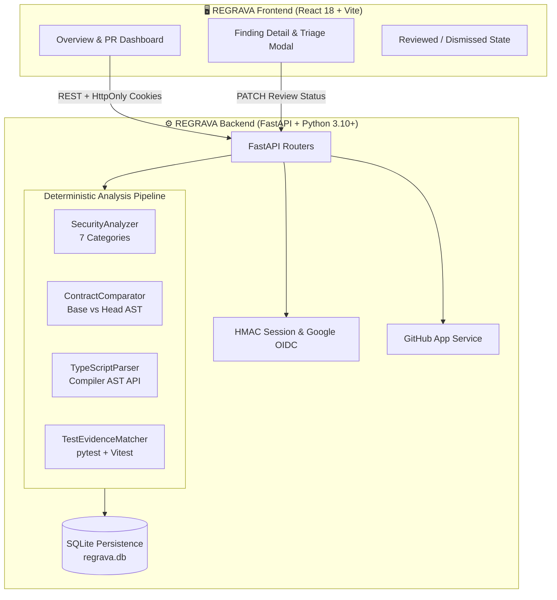

<div align="center">

# 🛡️ REGRAVA

### **Catch what your diff could break.**
*Deterministic Pull-Request Security, Injection Vulnerability & API Regression Intelligence*

<br/>

[](https://github.com/Myparadox-creator/REGRAVA)
[](https://fastapi.tiangolo.com)
[](https://www.typescriptlang.org)
[](https://react.dev)
[](https://vitejs.dev)
[](https://tailwindcss.com)
[](LICENSE)

<br/>

**[⚡ Quickstart](#-quickstart)** • **[🎯 The Problem We Solve](#-the-problem-we-solve)** • **[🛡️ 7-Layer Security Engine](#️-7-layer-security-engine)** • **[🏗️ Architecture](#️-architecture--data-flow)** • **[🖥️ Dashboard Tour](#️-developer-dashboard-tour)** • **[🔒 Zero-Retention Guarantee](#-zero-retention--privacy-manifesto)**

<br/>

---

</div>

<br/>

## 🌟 Executive Summary

> [!IMPORTANT]
> **REGRAVA is NOT an AI chatbot that hallucinates code reviews.**  
> It is an **evidence-based, deterministic static analysis platform** that inspects Git pull requests to detect **hard security flaws** (secrets, injections, SSRF, IDOR) and **breaking API contract regressions** before code reaches production.

Pull requests frequently introduce two distinct classes of silent bugs:
1. **Security Vulnerabilities:** Hardcoded API keys, unparameterized SQL queries, directory traversal in file handlers, unvalidated SSRF in HTTP clients, and wildcard CORS policies.
2. **Contract Regressions:** Breaking backend schema changes (such as renaming or deleting a Pydantic model field like `user_id` &rarr; `id`) that cause frontend React/TSX consumers to receive `undefined` at runtime.

REGRAVA uses **abstract syntax tree (AST) traversal, Git diff reading, credential scanning with automated redaction, and TypeScript cross-file reference tracking** to pinpoint vulnerabilities with mathematical certainty.

<br/>

---

## 🎯 The Problem We Solve

### Scenario A: The Silent API Contract Regression
Consider a FastAPI backend returning a payment user payload:

```python
# 🔴 BASE REVISION (backend/models.py)
class PaymentResponse(BaseModel):
    user_id: int    # Expected by frontend client
    amount: float
```

A React component reads the response:
```tsx
// 🟡 FRONTEND CONSUMER (frontend/src/PaymentCheckout.tsx)
const userId = response.user_id;  // Component relies on `user_id`
```

Later, a developer optimizes the response model in a pull request:
```python
# 🔴 HEAD REVISION (backend/models.py)
class PaymentResponse(BaseModel):
    id: int         # ⚠️ Renamed from user_id to id
    amount: float
```

```
┌────────────────────────────────────────────────────────────────────────┐
│                        REGRAVA DETECTIONS                              │
├────────────────────────────────────────────────────────────────────────┤
│ ❌ [HIGH REGRESSION] API Contract Field Removed: `user_id`             │
│    Changed File : backend/models.py:3                                  │
│    Affected File: frontend/src/PaymentCheckout.tsx:14                  │
│    Consumer Call: response.user_id                                     │
│    Test Evidence: ⚠️ No test assertions found for `PaymentResponse`     │
│    Remediation  : Update TSX consumer or alias `user_id = Field(...)`  │
└────────────────────────────────────────────────────────────────────────┘
```
**Result:** The backend responds with HTTP 200 OK, but the frontend silently renders blank or crashes with `TypeError`. **REGRAVA catches this before merge.**

---

### Scenario B: Hardcoded Secret & SQL Injection in PR Diff
A developer writes a quick database lookup:

```python
# ⚠️ Pull Request Diff: backend/routers/payment.py
STRIPE_SECRET = "sk_test_mock_secret_key_demo_only_123456789"  # High entropy secret!

@router.get("/transactions")
def get_transactions(user_input: str):
    # Unparameterized string formatting
    query = f"SELECT * FROM transactions WHERE account_id = '{user_input}'"
    cursor.execute(query)  # SQL Injection!
```

```
┌────────────────────────────────────────────────────────────────────────┐
│                        REGRAVA FINDINGS                                │
├────────────────────────────────────────────────────────────────────────┤
│ 🚨 [CRITICAL SECRETS] Hardcoded Stripe Live Secret Key Detected        │
│    Redacted Value : sk_test_mock_*********************************     │
│    Remediation    : Rotate secret immediately; use os.environ.get()    │
│                                                                        │
│ 🚨 [HIGH INJECTION] SQL Injection via Unparameterized Query String     │
│    Vulnerable Call: cursor.execute(f"SELECT * FROM ... '{user_input}'")│
│    Attack Vector  : Tainted argument passed directly to SQL executor    │
│    Remediation    : Use parameterized queries: execute("...", (id,))   │
└────────────────────────────────────────────────────────────────────────┘
```

<br/>

---

## 🛡️ 7-Layer Security Engine

REGRAVA evaluates diffs deterministically across seven specialized security and regression layers:

| Layer | Category | What REGRAVA Detects | Primary Technique | Redaction |
| :---: | :--- | :--- | :--- | :---: |
| **01** | `SECRETS` | AWS tokens, Stripe keys, GitHub PATs, private keys, high-entropy tokens | Regex + Entropy Heuristics | **Automatic** |
| **02** | `INJECTION` | SQLi via f-strings/concatenation, command injection (`shell=True`), XSS via `dangerouslySetInnerHTML` | AST Call & JoinedStr Visitor | &mdash; |
| **03** | `AUTH & IDOR` | Missing tenancy/user-ownership filters in database updates or deletes | AST Where-Clause Inspection | &mdash; |
| **04** | `INPUT & PATH` | Path traversal in `open()` / `os.path.join()`, and unvalidated SSRF in `httpx`/`requests` | Variable Origin & Path Confinement | &mdash; |
| **05** | `CONFIG` | Dangerous CORS (`allow_origins=["*"]` + `credentials=True`), risky GHA workflows (`pull_request_target`) | AST Middleware + YAML Parser | &mdash; |
| **06** | `DEPENDENCIES`| Pinned package versions with known vulnerabilities and CVE alerts | Semantic Constraint Matching | &mdash; |
| **07** | `API CONTRACT`| Removed schema fields, altered types, deleted routes, and unhandled frontend consumers | Python AST + TS Compiler API | &mdash; |

<br/>

---

## 🏗️ Architecture & Data Flow



<br/>

---

## 🖥️ Developer Dashboard Tour

The REGRAVA dashboard is organized around **four immediate questions**:

```
┌───────────────────────────────────┬───────────────────────────────────┐
│ 1. CONNECTED REPOSITORIES         │ 2. PULL REQUESTS NEEDING ATTENTION│
│ • demo-org/payment-service (Active)│ • PR #42: Migrate payment flow    │
│ • demo-org/user-service    (Active)│ • 4 Files changed (+42 / -18)     │
│ [ Manage GitHub Permissions ]     │ [ Inspect Diff & Run Scan ]       │
├───────────────────────────────────┼───────────────────────────────────┤
│ 3. SECURITY & CONTRACT FINDINGS   │ 4. ACTIONABLE REMEDIATION STEPS   │
│ 🚨 4 High Severity   🟡 1 Medium  │ ⚠️ Rotate exposed Stripe key      │
│ 🔷 1 Contract Delta  ⚪ 1 Test Gap│ ⚠️ Use parameterized SQL query     │
│ [ Explore Findings Explorer ]     │ ⚠️ Update PaymentCheckout.tsx     │
└───────────────────────────────────┴───────────────────────────────────┘
```

### Finding Detail & Triage Modal
Clicking any finding opens the comprehensive inspection view:
- **Plain-language summary** upfront for fast triage.
- **Source code reference** with exact line number.
- **Attack scenario & exploitation mechanics** explaining how an attacker could exploit the flaw.
- **Step-by-step remediation guide** with secure replacement code.
- **Technical AST evidence drawer** showing AST node names, parent calls, and conditions.
- **Triage Actions:** One-click **"Mark as Reviewed"** or **"Dismiss"** with persistent audit notes.

<br/>

---

## 🚀 Quickstart

### Prerequisites
- **Python 3.10+** (Tested on Python 3.10, 3.11, 3.12, 3.14)
- **Node.js 18+** & npm
- **Git**

```bash
# 1. Clone the repository
git clone https://github.com/Myparadox-creator/REGRAVA.git
cd REGRAVA
```

### Option A: 1-Click Launch (Recommended)

#### Terminal 1: Backend Server (FastAPI)
```bash
cd backend
python -m venv ../.venv

# Windows
..\.venv\Scripts\activate
# Linux / macOS
source ../.venv/bin/activate

pip install -r requirements.txt
python -m uvicorn app.main:app --port 8000 --reload
```
*Backend is live at `http://127.0.0.1:8000` (API Docs at `http://127.0.0.1:8000/api/docs`)*

#### Terminal 2: Frontend Server (Vite)
```bash
cd frontend
npm install
npm run dev
```
*Frontend is live at `http://localhost:5173`*

👉 **Open `http://localhost:5173` and click "Explore Demo Sandbox (1-Click)"** for an immediate, credential-free demonstration with live repositories and PR #42!

<br/>

---

## 🧪 Comprehensive Test Suite

REGRAVA includes a comprehensive automated test suite covering all security checks, contract diffing, and API routes:

```bash
# Run 38 Backend Tests
cd backend
python -m pytest -v
```

```
tests/test_api_endpoints.py::test_health_endpoint                     PASSED [  2%]
tests/test_auth_and_sessions.py::test_demo_login_and_session_cookie   PASSED [ 18%]
tests/test_security_analyzer.py::test_secret_scanning_and_redaction   PASSED [ 76%]
tests/test_security_analyzer.py::test_sql_injection_detection         PASSED [ 78%]
tests/test_security_analyzer.py::test_command_injection_detection     PASSED [ 81%]
tests/test_security_analyzer.py::test_xss_detection                   PASSED [ 84%]
tests/test_security_analyzer.py::test_missing_resource_ownership_check PASSED [ 86%]
tests/test_security_analyzer.py::test_path_traversal_detection        PASSED [ 89%]
tests/test_security_analyzer.py::test_ssrf_detection                  PASSED [ 92%]
tests/test_security_analyzer.py::test_insecure_cors_detection         PASSED [ 94%]
tests/test_typescript_parser.py::test_typescript_ast_property_access  PASSED [ 97%]
======================= 38 passed, 11 warnings in 3.86s =======================
```

```bash
# Run Frontend Tests & Production Build
cd frontend
npm test -- --run
npm run build
```

<br/>

---

## 🤖 GitHub Actions CI/CD Integration

Automate REGRAVA checks on every pull request. Add this workflow to `.github/workflows/regrava.yml`:

```yaml
name: REGRAVA Pull-Request Sentinel

on:
  pull_request:
    branches: [main, master]

jobs:
  analyze:
    name: Security & Regression Scan
    runs-on: ubuntu-latest
    steps:
      - name: Checkout Code
        uses: actions/checkout@v4
        with:
          fetch-depth: 0

      - name: Set up Python
        uses: actions/setup-python@v5
        with:
          python-version: '3.11'

      - name: Set up Node.js
        uses: actions/setup-node@v4
        with:
          node-version: '20'

      - name: Install Dependencies
        run: |
          python -m pip install --upgrade pip
          pip install -r backend/requirements.txt
          cd analyzer_ts && npm install

      - name: Run REGRAVA Scan
        run: |
          python -m backend.app.cli --repo . --base origin/${{ github.base_ref }} --head HEAD --fail-on high
```

<br/>

---

## 🔒 Zero-Retention & Privacy Manifesto

> [!NOTE]
> Developer security tools must never become a data liability. REGRAVA is architected from the ground up for strict privacy:

* 🚫 **Zero Source Code Execution:** Target code is never imported, compiled, or executed. Everything is inspected strictly as abstract syntax trees.
* 🛡️ **Automated Secret Redaction:** API keys, AWS credentials, and auth tokens are masked in-memory before reaching logs or the UI.
* 💾 **In-Memory & Ephemeral:** Source code diffs are analyzed in-memory. No client code is stored on disk or in remote databases.
* 🧠 **No External LLM Training:** Your code is never sent to third-party language models or training pools.
* 🔑 **Fine-Grained GitHub App Access:** Requires only read-only permissions on pull requests and repository metadata—no dangerous account-wide personal access tokens (PATs).

<br/>

---

## 🗺️ Project Structure

```
REGRAVA/
├── backend/                        # FastAPI Application & Analysis Engine
│   ├── app/
│   │   ├── analyzer/               # Deterministic Analyzers
│   │   │   ├── security_analyzer.py# 7 Security Categories
│   │   │   ├── contract_comparator.py# Pydantic Base vs Head Diff
│   │   │   ├── typescript_parser.py# TypeScript Compiler API Bridge
│   │   │   └── test_evidence.py    # Test Coverage Discovery
│   │   ├── api/                    # REST Endpoints (Auth, PRs, Repos)
│   │   ├── db/session_db.py        # SQLite Local Persistence
│   │   ├── services/               # GitHub App Client & PR Analysis
│   │   └── main.py                 # Application Entry Point
│   └── tests/                      # 38 Automated Backend Tests
├── frontend/                       # Modern React + Vite Dashboard
│   ├── src/
│   │   ├── components/             # Header, Sidebar, FindingDetailModal
│   │   ├── pages/                  # Overview, PullRequests, Findings, Settings
│   │   ├── services/api.ts         # Typed API Client
│   │   └── types/index.ts          # Domain Models & Finding Types
├── analyzer_ts/                    # TypeScript AST Subprocess Analyzer
└── docs/                           # Threat Model & Supported Patterns
```

<br/>

---

## 📄 License

This project is licensed under the **MIT License** — see the [LICENSE](LICENSE) file for details.

<div align="center">
<br/>

**REGRAVA** &bull; *Catch what your diff could break.*  
Built with ❤️ for full-stack developers and high-assurance engineering teams.

</div>
