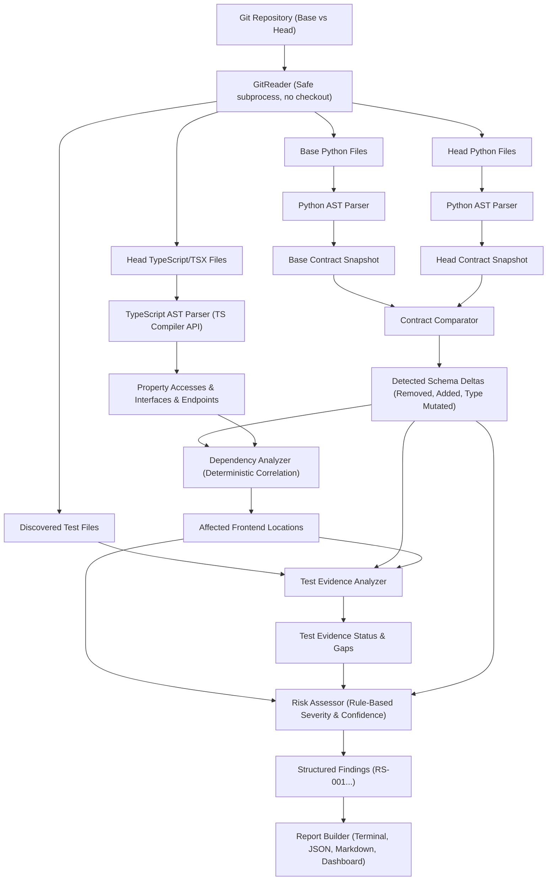

# RepoSentinel Architecture

RepoSentinel is an evidence-based regression risk analysis system for full-stack applications (Python/FastAPI + React/TypeScript). It determines whether modifications to backend API contracts break frontend consumers, verifies test evidence, and provides explainable findings before merging pull requests.

## High-Level Architecture

## Core Modules

### 1. `backend/app/analyzer/git_reader.py`
- Operates on Git objects directly using array-based arguments (`git show <ref>:<path>`) without checking out code or modifying the working directory.
- Strictly validates commits, detects file additions, deletions, modifications, and renames.
- Enforces strict file-size limits (default 1MB) and command timeouts.
- Guards against path traversal (`..` escape attempts).

### 2. `backend/app/analyzer/python_parser.py` & `contract_extractor.py`
- Statically parses Python code using the standard library `ast` module.
- Extracts FastAPI routes (`@app.get`, `@router.post`, etc.), HTTP methods, path strings, explicit `response_model`, parameter definitions (required vs optional, Path, Query, Body), and docstrings.
- Resolves Pydantic models across files, mapping attributes, types, and defaults.
- Recovers gracefully from syntax errors without crashing the entire run.

### 3. `analyzer_ts/analyze.ts` & `backend/app/analyzer/typescript_parser.py`
- Uses the official **TypeScript Compiler API** (`ts.createSourceFile`) for 100% deterministic syntax-tree inspection.
- Extracts property accesses (`user.user_id`), destructuring bindings (`const { user_id } = res`), interface declarations, type alias property signatures, endpoint string literals (`/api/users`), and test declarations (`it`, `test`, `describe`).
- Communicates with the backend engine via JSON over stdin/stdout.

### 4. `backend/app/analyzer/contract_comparator.py`
- Compares base and head contract snapshots.
- Identifies removed fields, added fields (non-breaking), type mutations, removed routes, and newly required request parameters.
- Incorporates heuristic detection for possible renames (e.g. 1 field removed and 1 field added to the same model).

### 5. `backend/app/analyzer/dependency_analyzer.py`
- Correlates backend contract mutations with frontend consumers using explainable rules:
  - **High Confidence**: Direct route string match in same consumer file + property access or TypeScript interface match.
  - **Medium Confidence**: Property access on common response variable (`response`, `data`, `res`, `user`).
  - **Low Confidence**: Isolated property name match without route context.

### 6. `backend/app/analyzer/test_evidence.py`
- Scans pytest test files and frontend test declarations.
- Checks whether tests reference affected endpoints, models, or field names.
- Outputs `found`, `not_found_by_analyzer`, or `unknown`.
- Never equates static test presence with runtime verification.

### 7. `backend/app/analyzer/risk_assessor.py` & `report_builder.py`
- Assigns distinct **Severity** (impact if real) and **Confidence** (evidence strength).
- Compiles actionable recommendations and multi-line evidence trails.
- Emits formatted Terminal text, JSON, and GitHub Actions Markdown summaries.
